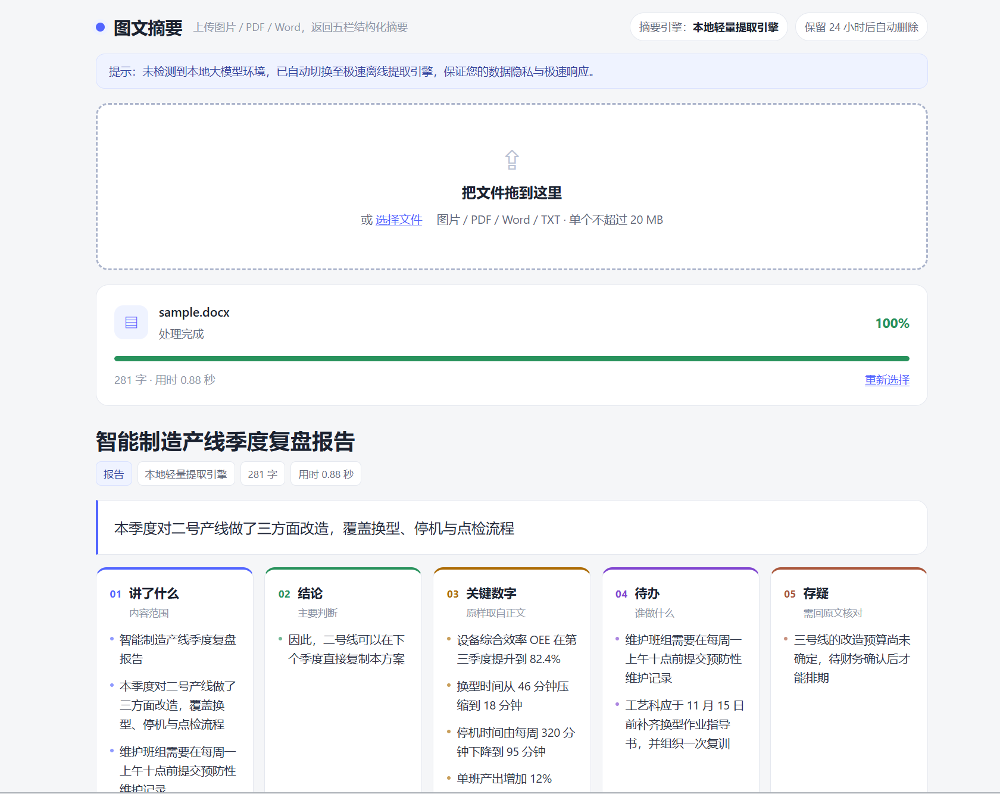

# 图文摘要 · 纯本地五栏摘要系统

> 把一张图片或一份 PDF / Word 拖进浏览器，几秒内拿到「讲了什么 / 结论 / 关键数字 / 待办 / 存疑」五栏结构化摘要 —— 全程在你自己的电脑上跑，不联网、不买域名、不需要 GPU。



`纯 Python` · `FastAPI + 原生 HTML/JS` · `SQLite` · `CPU 推理` · `双引擎自动降级` · `24 小时自动删除` · `MIT License`

---

## 目录

- [1. 这是什么](#1-这是什么)
- [2. 核心亮点：双引擎自动降级](#2-核心亮点双引擎自动降级)
- [3. 环境要求](#3-环境要求)
- [4. 三步启动](#4-三步启动)
- [5. 怎么用](#5-怎么用)
- [6. 隐私说明](#6-隐私说明)
- [7. 已知限制](#7-已知限制)
- [8. 项目结构](#8-项目结构)
- [9. 配置项](#9-配置项)
- [10. 接口](#10-接口)
- [11. 开源协议](#11-开源协议)

---

## 1. 这是什么

一个**完全离线**的「文件 → 摘要」Web 应用。后端 FastAPI，前端零框架（原生 HTML/CSS/JS 单文件），数据库用标准库 sqlite3。

它不做"把全文丢给大模型"的黑盒，而是拆成三段可验证的流水线：

| 阶段 | 做什么 | 用什么 |
|---|---|---|
| 抽取 | 图片 OCR、PDF 文本层 / 扫描页、Word 正文与表格 → 纯文本 | RapidOCR（ONNX）、PyMuPDF、python-docx |
| 摘要 | 纯文本 → 五栏结构化结果 | 本机 Ollama（有就用）／离线提取引擎（兜底） |
| 交付 | 上传即返回 `task_id`，后台线程慢慢跑，前端轮询进度 | threading + SQLite |

**五栏**是本项目区别于"通用摘要工具"的地方：

| 栏 | 回答的问题 |
|---|---|
| 讲了什么 | 这份文件的内容范围 |
| 结论 | 作者的判断 / 最终结论 |
| 关键数字 | 原样抄自正文的数据，不做换算 |
| 待办 | 谁、在什么时候、要做什么 |
| 存疑 | 文中缺失或含糊的地方——**某一栏为空时，这里会解释原因** |

结果支持**一键导出 Markdown**（`摘要_时间戳.md`），纯前端生成，不经过任何服务器。

---

## 2. 核心亮点：双引擎自动降级

这是本项目保证「**评委电脑上 100% 能跑起来**」的关键设计。

| 条件 | 使用的引擎 | 速度（实测） | 输出特点 |
|---|---|---|---|
| 本机有 Ollama 且装了模型 | **本机大模型**（如 qwen2.5） | 5 ～ 13 秒 | 模型改写，语句通顺、要点归纳更自然 |
| 没装 Ollama / 连不上 / 模型报错 | **极速离线提取引擎** | 纯文本 0.03 ～ 0.05 秒<br>A4 图片 1.4 秒 | 原句抽取 + 规则切栏，可逐句回查原文 |

**三层保护，任何一层失败都不会让程序崩掉：**

```
本机大模型  →  离线提取引擎（TextRank 选句）  →  最小可用结果（标题 + 首段）
```

具体机制：

- 启动和每次摘要前，都会探测 `127.0.0.1:11434` 的 `/api/tags`，**真的确认有模型**才启用大模型，而不是"端口能连上就算"
- 探测结果缓存 15 秒，页面加载 + 紧接着的上传只付一次探测成本
- 调用失败、超时、模型不存在（404）都会自动重试候选模型，全部失败则静默降级
- **绝不抛出异常给用户**：`summarize()` 的语义就是"永远返回一个五栏结果"
- 前端顶部会显示提示条：*未检测到本地大模型环境，已自动切换至极速离线提取引擎*
- 接口在 `/info`、`/upload`、`/status`、`/result` 里都返回 `engine_used` 字段，当前用的是哪个引擎一眼可见

> 换句话说：**装了大模型更好，没装也照样能用**。评委不需要为了跑这个项目去装 Ollama。

---

## 3. 环境要求

| 项目 | 要求 |
|---|---|
| 操作系统 | Windows 10 / 11（主目标）；Linux / macOS 代码可跑，但 `run.bat` 不适用 |
| Python | **3.10 / 3.11 / 3.12** |
| 内存 | ≥ 4 GB |
| 磁盘 | ≥ 1.5 GB（虚拟环境 + 依赖） |
| GPU | **不需要，全部推理走 CPU** |
| 网络 | 仅首次安装依赖需要；之后可完全断网运行 |

> ⚠️ **不建议 Python 3.13 及以上。**
> OCR 依赖 `rapidocr-onnxruntime` 与 `pyclipper` 在 3.13+ 上没有预编译包，`pip install` 会失败。`run.bat` 会在装依赖前先校验版本，并给出明确提示，不会让你装到一半才炸。

> 💡 **Windows 安装 OCR 依赖一句话方案**：
> `pip install rapidocr-onnxruntime` 就够了 —— **中文检测与识别模型（约 15 MB）直接打包在 wheel 里**，不需要另外安装 Tesseract / PaddlePaddle、不需要 CUDA、不需要配置系统环境变量、不需要单独下载模型文件。

---

## 4. 三步启动

### 第 1 步 · 拿到代码

```bash
git clone <你的仓库地址> photo-doc-summarizer
cd photo-doc-summarizer
```

没有 git 就下载 ZIP 解压，效果一样（注意解压后要进入文件夹，不要在压缩包预览窗口里直接双击）。

### 第 2 步 · 双击 `run.bat`

**就这一件事，剩下的脚本全包了。** 双击后的流程：

```
[1/4] Creating virtual environment...       ← 首次：自动创建 venv（约 10 秒）
[2/4] Activating virtual environment...     ← 激活环境
[3/4] Installing dependencies...            ← 首次：自动下载约 150 MB 依赖
                                               走清华镜像，通常 2-5 分钟
                                               请勿关闭窗口，黑框不是卡死
[4/4] Starting server...                    ← 启动服务，3 秒后自动打开浏览器
```

> **首次运行要等 2 ～ 5 分钟下载依赖（约 150 MB），这是正常的。**
> 脚本会打印 `Installing dependencies...` 并在最后打印 `dependencies ready.`。
> 装完之后会写一个 `.deps-ok` 标记，**第二次打开就是秒启动**。

### 第 3 步 · 开始使用

浏览器会自动打开 `http://127.0.0.1:8000`。如果没弹出来，手动访问即可。

**失败也不会闪退**：任何一步出错，脚本都会停在黑框里显示英文错误原因，按任意键才关闭。

---

## 5. 怎么用

1. 把文件**拖进**页面中央的虚线框，或点「选择文件」
2. 进度条实时显示阶段（上传 → 抽取 → `OCR 第 n/m 页` → 生成摘要）
3. 完成后展开五栏结果，可点「导出摘要 .md」保存，或继续拖下一个文件

### 支持的文件格式

| 类型 | 扩展名 | 处理方式 |
|---|---|---|
| 图片 | `.png` `.jpg` `.jpeg` `.webp` `.bmp` `.tif` `.tiff` | EXIF 方向纠正 → RapidOCR 识别 |
| PDF（有文本层） | `.pdf` | PyMuPDF 直接抽文本，**不跑 OCR**（快） |
| PDF（扫描件） | `.pdf` | 逐页渲染 200 dpi → OCR（最多前 50 页） |
| Word | `.docx` | python-docx，正文 + 表格（表格按行打平成 `列 \| 列`） |
| 纯文本 | `.txt` `.md` | 直读，UTF-8 / GBK 编码自动兜底 |

**不支持**（上传阶段就会被拦下并提示）：`.doc` / `.wps` 老格式、`.xlsx` / `.pptx`、加密 PDF、单文件超过 20 MB、超过 200 页。

### 实测速度

> 测试环境：Windows / Python 3.12.10 / **无 GPU** / 本机 Ollama `qwen2.5-coder:7b`

| 场景 | 耗时 | 说明 |
|---|---|---|
| 150 字 Word（含表格）→ 抽取式五栏（端到端） | **0.03 ～ 0.05 秒** | 纯文本路径，几乎瞬时 |
| 同内容 → 本机 7B 模型五栏 | **5 ～ 13 秒** | 随输出长度波动 |
| A4 图片（1266×1772，轻微倾斜）OCR | 首次 **7.3 秒**（含模型加载）／之后 **1.4 秒** | 123 字，识别准确 |
| 10 页扫描件 PDF | 约 **15 ～ 25 秒** | 按 1.4 秒/页推算 |

---

## 6. 隐私说明

这条不是宣传语，是可以逐条验证的：

| 承诺 | 实现方式 | 怎么验证 |
|---|---|---|
| **不上传任何外部服务** | 运行期零外部网络请求；调本地模型时有硬闸——host 不是 `127.0.0.1 / localhost / ::1` 直接拒绝 | 打开 `GET /info`，看 `privacy.network` 与 `ollama_base_url` |
| **原始文件 24 小时后自动删除** | 记录和原文件一起删；启动清一次 + 后台线程每 30 分钟清一次 + 孤儿文件按 mtime 兜底 | 设 `RETENTION_HOURS=0.01`（36 秒），上传后等一会儿刷新 `/history`，`data/uploads/` 里的文件会消失 |
| **不收集任何数据** | 无埋点、无统计上报、无账号体系；数据库就是你本机的一个 `data/app.db` 文件 | 全文搜索 `urlopen`，只有本机 Ollama 一处调用 |
| **不对外暴露** | 默认只绑定 `127.0.0.1:8000`，局域网内其他机器访问不到 | `netstat -ano \| findstr 8000` |

---

## 7. 已知限制

如实写，这些是边界，不是 bug：

**识别质量**

- **OCR 对图像质量高度敏感**：模糊、倾斜、逆光、手写字识别率会明显下降，可能有错字
- **表格会被打平**：Word / PDF 表格转成 `列 | 列` 的纯文本，合并单元格会重复文本，**不保留表格结构**
- **PDF 分栏排版按行读**，左右两栏可能交错
- **扫描件只 OCR 前 50 页**，超出部分会在正文里注明

**离线提取引擎的边界（没装大模型时会走这条路）**

- 它是**选句**不是改写，语言连贯性明显不如大模型，读起来会有"拼句感"
- "待办""存疑"依赖规则词命中（需要/务必/建议/待确认/风险……），措辞隐晦的文档可能漏掉
- 中文数字识别（百分之八十、第一步）依赖正则，个别写法可能漏抓

**性能**

- 超长文档：本机 7B 模型处理几千字要分钟级；**只把正文前 5000 字送给模型**，超出部分会在结果里给 warning
- 图片首次识别有 1～2 秒的 OCR 模型加载时间（之后常驻内存）
- 后台只有 2 个工作线程，同时传多个文件会排队

**工程边界**

- 单机单实例：SQLite + 线程池，**不是分布式**，不面向多人同时使用
- 仅 Windows 提供 `run.bat`；Linux / macOS 需手动起 uvicorn
- PDF 引擎 PyMuPDF 采用 **AGPL-3.0**（比赛与个人使用无碍，商业使用需另购授权或换 `pypdf`）

---

## 8. 项目结构

```
photo-doc-summarizer/
├─ run.bat                 一键启动：查版本 → 建环境 → 装依赖 → 起服务 → 开浏览器
├─ requirements.txt        8 行依赖，无 torch / 无 paddle
├─ LICENSE                 MIT
├─ app/
│  ├─ main.py              FastAPI 入口：路由、校验、异常处理
│  ├─ extract.py           文件 → 文本（OCR / PDF / DOCX / TXT）
│  ├─ summarize.py         文本 → 五栏摘要（大模型 / 提取式 / Mock）
│  ├─ jobs.py              threading 后台任务队列
│  └─ store.py             SQLite 存储 + 24 小时保留期清理
├─ web/
│  └─ index.html           单文件前端，零框架，含 Markdown 导出
├─ docs/
│  └─ screenshot.png       README 截图
├─ samples/                演示样例（png / pdf / docx）
└─ data/                   运行时生成，已 gitignore
   ├─ app.db
   └─ uploads/
```

## 9. 配置项

全部走环境变量，改 `run.bat` 或系统环境变量即可，不用改代码：

| 变量 | 默认 | 作用 |
|---|---|---|
| `SUMMARY_PROVIDER` | `auto` | `auto` / `extractive` / `ollama` / `mock` |
| `OLLAMA_MODEL` | 自动探测 | 指定本机模型名，如 `qwen2.5:7b-instruct` |
| `OLLAMA_BASE_URL` | `http://127.0.0.1:11434` | 非本机地址会被拒绝 |
| `OLLAMA_TIMEOUT` | `180` | 调本机模型的超时秒数，超时即降级 |
| `RETENTION_HOURS` | `24` | 数据保留小时数 |
| `CLEAN_INTERVAL_SECONDS` | `1800` | 后台清理间隔 |
| `JOB_WORKERS` | `2` | 后台工作线程数 |

## 10. 接口

| 方法 | 路径 | 说明 |
|---|---|---|
| `GET` | `/` | 前端页面 |
| `POST` | `/upload` | 上传文件，**立刻返回 202 + task_id** |
| `GET` | `/status/{id}` | 进度（0-100 + 阶段文案）、状态、`engine_used` |
| `GET` | `/result/{id}` | 五栏结构化摘要 + `engine_used` |
| `GET` | `/history` | 最近任务（超过保留期自动消失） |
| `GET` | `/info` | 当前摘要引擎 + 存储统计 + 隐私状态 |
| `GET` | `/docs` | FastAPI 自动生成的接口文档（答辩现场很好用） |

## 11. 开源协议

本项目采用 **MIT License**，全文见 [LICENSE](LICENSE)。

- **代码**：全部在本仓库，无闭源组件
- **模型**：OCR 模型随 `rapidocr-onnxruntime` wheel 分发（Apache-2.0）；生成式摘要使用你本机安装的 Ollama 模型，仓库不分发任何模型权重
- **依赖许可**：FastAPI (MIT)、uvicorn (BSD)、python-docx (MIT)、Pillow (HPND)、jieba (MIT)、rapidocr-onnxruntime (Apache-2.0)、**PyMuPDF (AGPL-3.0)**
- **不含**：任何用户数据、任何真实文档、任何 API Key
